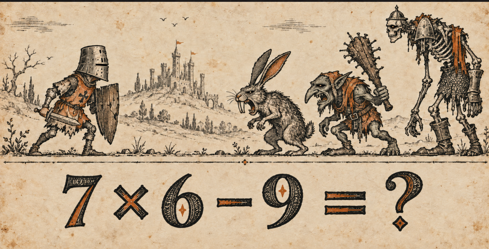

# Medieval Math — art direction

CURRENT MODES (5 November 2026): The Village Idiot = choose an action, then maths;
The Knight = a party card deck, then maths; The Fellowship = pure maths with every
living companion attacking on each success, no combat selection. Fellowship has
its own save/scoreboard and fixed 2× enemy HP; weapon upgrades increase each owner's
contribution. Role volleys: knights cleave two, wizard/fire hit all; failed combat
sums add one shared party damage per caster (armour first). Priests heal when wounded,
otherwise staff attack; executioners double damage at half HP. Keep actual riddles
and the original hihuuu greeting. See fellowship-roles-36 at the top of the handoff.
The Bard is retired; preserve its archived saves/scores. See the current notes at
the top of GAME_DESIGN.txt and HANDOFF.md for Fellowship tuning and exceptions.

CURRENT UI (action-cards-34): use the shared large square action cards for Village
Idiot combat, shops and camp/road actions; retain framed riddles and tavern dialogue.
The Knight keeps its actual deck. Magic/fire reward and failure risk remain central.

## CORE DESIGN RULE — POWER, DIFFICULTY AND RISK

**Non-negotiable, confirmed by Magnus on 5 November 2026:** weak attacks are easier
and weaker; strong attacks are harder and stronger; powerful spells are hard and
risky. Preserve this relationship in every challenge format and future port.
Temporary buffs and upgrades may deliberately reduce execution difficulty; never
silently cancel their benefit by scaling difficulty back up. A powerful found
sword or mage staff can initially demand a formidable challenge; blacksmith
refinement makes it manageable for later biomes without merely stripping its power.
Failed fire-bottle throws can ignite the player's own party, with another living
companion reacting in written dialogue. Communicate damage, difficulty and risk
clearly before commitment. Preserve existing buff durations and wizard backfire rules.

Fellowship now has per-caster fire/lightning backfires and a companion reaction.
The Knight's existing backfires remain. Village Idiot fire-failure changes and
weapon/refinement progression remain **approved design awaiting implementation**.
Read [GAME_DESIGN.txt](../GAME_DESIGN.txt) for the full rule and implementation status. This rule supersedes
conflicting historical notes; do not flatten it during balancing.

The visual authority is **approved-concept-eyes.png in this folder**, the corrected concept with helmet down, small eye shadows and tiny pale eye highlights. Open that image before editing art. The first concept with large staring eyeballs is historical, not the eye reference. The original concept remains the authority for proportions, density and humour; later generated sheets are not new style references.

## Reference colour families — not a strict limit

On 5 November Magnus withdrew the strict colour restriction. These are useful reference families, not a mandatory quantisation palette. Preserve the approved knight’s natural printed colour variation. Use restrained earth tones where they improve material separation, such as the enemy peasant’s cap, cloth and boots. Continue comparing everything with the concept; avoid blanket yellow/orange casts. `src/config/palette.js` calibrates particular assets rather than imposing a universal colour limit.

| Pigment | Hex | Use |
| --- | --- | --- |
| Charcoal | `#24241C` | Outlines, carved hatching, eye shadows |
| Warm ink grey | `#6C6050` | Muted shading; never a blurred edge halo |
| Leather brown | `#80644C` | Worn caps, boots, wood, leather |
| Parchment | `#E4CCB4` | Skin, plain cloth, stone, paper interiors |
| Pale parchment | `#ECDCC4` | Tiny eye glints and sparse light marks |
| Dirty orange | `#AC5C24` | Clothing, flags, symbols; starter cap and shirt may use as much orange as the approved knight |

The scene and bottom menu share the actual in-game parchment texture. Do not bake a new yellow, salmon, bright cream or white rectangle into an environment. Characters must not have yellow/orange skin. The starter cap and tunic can be dirty orange, with the same coverage as the knight’s clothing. Preserve stippling and dark ink. Skin stays separate; never use a screen-wide tint. Existing explicitly requested HUD health/armour states are separate functional UI; this table governs illustrated artwork.

## Drawing language

Irregular medieval woodblock prints, coarse black edges, fine carved hatching, worn print breaks. Flat ink on aged paper. Shabby, absurd medieval comedy. Avoid realistic skin, smooth digital gradients, glossy metal, polished cartoon faces and soft grey smudges. Detail must read at the actual display size: reduce the number of strokes on small icons, not the stroke weight. Do not enlarge a tiny drawing until its ink becomes coarser than the character.

## Faces and characters

- Small shaded eye areas with one tiny pale dot per visible living eye. No large white eyeballs, no empty demon sockets on living companions. The one-eyed riddler's empty socket is an intentional exception.
- Dark Wizard: still strange, mildly sinister and dishevelled; human rather than goblin-like, slightly friendlier brow/mouth, visible tiny highlights. Keep the taped eyeball on his black hat.
- Starter: same approved v20 body, straight hair, natural short nose. Fitted leather cap covers his ears. Simple wooden stick replaces empty hands until sword purchase. No bonus stats for the cap/stick.
- Preserve identity, silhouette, head scale and outfit between idle, walk, attack and tavern poses. Reuse existing attachments. Do not redraw a complete character to change one accessory.
- Fully equipped knight and approved rigid walk remain the reference. Do not revive the cancelled experimental humanoid rig.

## Motion

Keep feet in side view, planted at the ground line, same limb lengths, weighted torso/arm/head response. Current starter stride is the v21 longer stride; do not speed up planting again. Equipment follows its owning hand/head. Hat tip and facial design cannot switch orientation between walk frames. Deaths/violent attacks use the approved chunky held drawings rather than smooth puppet flopping. All frames must be reviewed together and in motion.

## World, composition and UI

Distant castle; airy hills with negative space; larger near props; complete tree/cliff silhouettes. Ground ends taper through drawn contours and scattered hatching, never clipped objects or opacity fades. Opaque interiors prevent lines behind trees/houses showing through. Village churches are unique landmarks, not repeated tiles. Ground is the visual separator, ornate divider below it, sums and choices below that. Title/subtitle sit centred in the sky on the title screen. Speech frames remain unstretched and point toward the speaker without covering faces.

## Required comparison before delivery

1. Open the corrected concept, source asset and proposed result together. Check the face/eyes, palette, outline weight, hatching density and proportions.
2. Check at actual game size on the real parchment, beside an existing approved companion. A giant standalone preview is insufficient.
3. For animation, inspect every atlas frame, fixed attachments, baseline and the actual moving loop. Do not label a contact sheet a finished animation.
4. Check indoor/outdoor transitions and the bottom menu for colour seams; check opaque interiors and unclipped limbs/artwork.
5. Verify loading, outfit upgrades and English/Japanese layouts as applicable. Preserve user saves and keep audio muted during tests.
6. State exactly what was checked. New generated art stays a proposal until Magnus approves it; do not call it approved because a tool generated it.

## Implementation notes

The palette renderer converts calibrated source-paper colours into the shared inks at draw time; originals are retained. Tavern environment silhouettes still cover scenery behind them. Sprite alpha is unchanged by palette mapping. Calibration is per asset, because treating yellow source paper as white causes colour drift. Do not add new calibration values or hues without comparing a rendered screenshot to this reference.

## Current edit sources and review files

- [Starter cutouts and atlases](../assets/villager-start/v22/) — original body/legs, new cap and gripping hand/stick.
- [Wizard atlas](../assets/wizard-riddles/v22/wizard.png) — edited faces, consistent hat direction, clean alpha.
- [Exact prompts](generation-prompts.json) — builtin ImageGen, not CLI.
- [Rendered starter](starter-check.png) and [tavern](tavern-check.png) — actual game colour treatment.
- The original character and environment source images remain retained. New PNGs are source art; final colour is applied by the renderer.

## stakes-37 rendering corrections

Use the existing opaque wooden cross drawing for all death-marker IDs; no rounded
translucent placeholder tombstones. Preserve companion grave spacing/depths. Dark
Wizard uses the original atlas colour variation and black ink, not the flattening
grey palette remap. Geometry, poses, eye glints and hat remain the same.

## Timer reference — 6 November 2026

Magnus approved the timer styling in `concepts/swamp-tunnel-concept-v1.png`.
Use its small shield, horizontal flaming sword, horizontal ordinary sword and twig,
with worn flat orange ink on a thin track, above a separate fine diamond divider.
`assets/timing-woodcut` contains cutouts of those exact drawings; no redraw. Keep
small icons at their intended scale. Do not restore the wide glow or generic upright
icons. Threshold positions remain driven by the current timing rules and upgrades.
